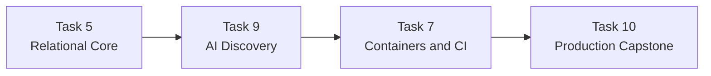

# Elevvo Backend Development Internship

This repository documents my practical work during the one-month Backend
Development Internship at Elevvo. The program is remote and self-paced, started
on October 20, 2026, and focuses on building industry-oriented backend projects
with modern TypeScript infrastructure.

> This is a personal portfolio repository. It is not an official Elevvo
> repository, and the internship's private materials and offer documents are
> intentionally not included.

## Program overview

The one-month track requires the completion of at least four tasks selected
from the available backend challenges. The projects are designed to exercise
real-world tools and practices rather than isolated syntax exercises.

My selected tasks form one progressive technical path:

1. establish reliable relational persistence and transactional behavior;
2. add AI-powered semantic product discovery;
3. automate testing, container builds, and delivery checks;
4. integrate the modules into a production-oriented e-commerce capstone.

The planned implementation order is **Task 5 -> Task 9 -> Task 7 -> Task 10**.

## Selected tasks

| Task | Focus | Status | Repository area |
|---|---|---|---|
| 5 | PostgreSQL, Prisma, relationships, migrations, and atomic checkout | Implemented and verified locally | [`task-05-relational-persistence`](task-05-relational-persistence) |
| 9 | Semantic search, embeddings, pgvector, and Redis result caching | Initial scaffold and specification | [`task-09-semantic-search`](task-09-semantic-search) |
| 7 | Multi-stage Docker builds and automated CI quality gates | Planned | [`task-07-docker-ci-cd`](task-07-docker-ci-cd) |
| 10 | Production-grade e-commerce integration and cloud delivery | Planned | [`task-10-production-ecommerce`](task-10-production-ecommerce) |

## Technical progression



### Task 5 - Relational core

Task 5 provides the durable product, user, cart, order, and inventory model. Its
checkout uses a serializable Prisma transaction, conditional stock deductions,
historical item snapshots, and complete rollback behavior.

### Task 9 - AI discovery

Task 9 will transform product descriptions and natural-language queries into
dense embeddings, store product vectors in PostgreSQL with pgvector, rank
results by cosine similarity, and cache repeated query results in Redis.

### Task 7 - Delivery automation

Task 7 will package the API using a multi-stage Docker build and introduce
automated quality gates for type checking, tests, and production builds.

### Task 10 - Production integration

Task 10 will assemble the previous modules into a single production-oriented
e-commerce API with authentication, authorization, caching, distributed rate
limiting, cloud infrastructure, migrations, deployment checks, and rollback
documentation.

## Repository structure

```text
.
|-- task-05-relational-persistence/  # Completed relational persistence project
|-- task-09-semantic-search/         # Initial semantic-search scaffold
|-- task-07-docker-ci-cd/            # Planned container and CI project
|-- task-10-production-ecommerce/    # Planned integration capstone
|-- specs/                            # Detailed implementation specifications
|-- TASK_PROJECT_STANDARDS.md         # Shared language, quality, and evidence rules
`-- README.md                         # Internship portfolio overview
```

## Shared project standards

Every task follows the rules in
[`TASK_PROJECT_STANDARDS.md`](TASK_PROJECT_STANDARDS.md):

- all authored content is in English;
- every task remains independently understandable and runnable;
- secrets and private internship documents are never committed;
- each completed task includes automated validation;
- each completed task provides a functional, screenshot-ready demonstration;
- Windows launchers operate only on resources owned by their task;
- implementation claims must be backed by real tests or runtime evidence.

## Demonstration strategy

The internship requires public portfolio evidence. Each task therefore has a
demonstration format suited to its actual backend behavior:

| Task | Planned portfolio evidence |
|---|---|
| 5 | Relational diagram, successful checkout, rollback response, and passing tests |
| 9 | Semantic Search Lab showing relevance, similarity, cache status, and latency |
| 7 | Container image stages, healthy services, and passing/failing CI quality gates |
| 10 | Published API, deep health data, deployment workflow, and end-to-end smoke test |

These artifacts are generated from the real implementation. Mocked screenshots
or fabricated performance results are not accepted as evidence.

## Four-week roadmap

| Week | Primary outcome |
|---|---|
| 1 | Complete PostgreSQL, Prisma, migrations, relationships, and checkout |
| 2 | Build the embedding pipeline, vector search, Redis caching, and search demo |
| 3 | Add Docker packaging, integration tests, and CI quality gates |
| 4 | Integrate security, caching, cloud deployment, and final evidence |

The plan preserves the required four-task submission while allowing each task
to remain a useful standalone portfolio project.

## Current progress

- [x] Task selection and one-month action plan
- [x] Shared repository and evidence standards
- [x] Task 5 implementation and automated verification
- [x] Task 9 implementation specification
- [x] Task 9 initial repository scaffold
- [ ] Task 9 functional implementation
- [ ] Task 7 implementation
- [ ] Task 10 implementation and cloud delivery
- [ ] Final public demonstration post and internship submission

## Privacy and source-material policy

This repository contains only my implementation, architecture decisions,
documentation, tests, and portfolio evidence. The following remain private:

- internship offer documents;
- personal contact information and signatures;
- course PDFs and internal reference materials;
- submission links and private administrative instructions;
- local environment files, credentials, model caches, and database data.

## Acknowledgement

This work is being developed as part of the Elevvo Backend Development
Internship. The program provides the task context and educational references;
all implementation and portfolio documentation in this repository represent my
own internship work.

