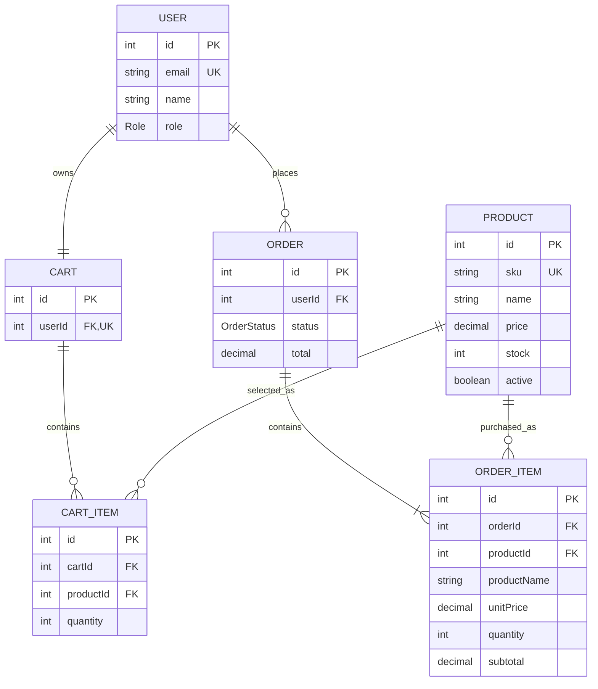

# Relational Model

## Integrity decisions

- `OrderItem` materializes the many-to-many relationship between orders and
  products.
- Product name and price are copied into `OrderItem` to preserve order history.
- Products are deactivated instead of physically deleted.
- A cart does not reserve stock; final validation occurs during checkout.
- PostgreSQL constraints prevent non-positive prices and quantities and prevent
  negative stock.

