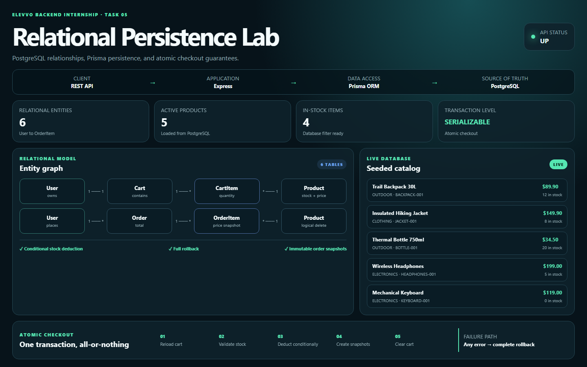

# Task 5 Visual Evidence

This directory contains portfolio-ready evidence generated from the running application.

The screenshot demonstrates:

- the live API health state;
- the relational domain model;
- seeded product data returned by the REST API;
- inventory indicators; and
- the atomic checkout transaction flow.

The visual lab is available at `http://localhost:3000/demo` while the API is running.

## Captured evidence

The final screenshot is generated from the real application and stored as
`task-05-relational-persistence-lab.png`.
