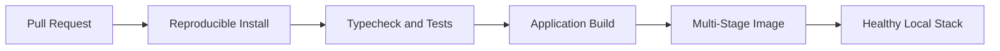

# Task 7 - Multi-Stage Dockerization and Automated CI/CD

## Status

**Planned.** This directory currently contains the portfolio and implementation
outline only. No Task 7 application code, Docker image, or workflow is claimed
as complete.

## Goal

Package a tested TypeScript backend into a production-oriented multi-stage
Docker image and enforce automated quality gates through GitHub Actions.

## Planned scope

- consolidate unit, HTTP, and integration test suites;
- create separate dependency, build, and runtime Docker stages;
- keep development dependencies and source files out of the runtime image;
- run the compiled application as a non-root user;
- orchestrate the API, PostgreSQL, and Redis with health checks;
- trigger CI on pull requests and pushes to the main branch;
- run lockfile installation, type checking, tests, and production build;
- build the Docker image only after quality checks pass;
- prevent secrets and local environment files from entering the build context.

## Planned architecture



## Planned repository structure

```text
task-07-docker-ci-cd/
|-- .github/workflows/
|-- docs/evidence/
|-- src/
|-- tests/
|-- .dockerignore
|-- .env.example
|-- compose.yaml
|-- Dockerfile
|-- package.json
|-- README.md
`-- task.bat
```

## Planned local commands

```bat
task.bat run
task.bat demo
task.bat test
task.bat verify
task.bat stop
```

These commands are placeholders in the project plan and do not exist yet.

## Planned portfolio evidence

- final runtime image size and stage summary;
- API, PostgreSQL, and Redis reported as healthy;
- successful GitHub Actions run;
- controlled failing run that demonstrates the quality gate;
- containerized API response from the real application.

## Definition of Done

Task 7 will be complete when a clean clone can pass CI, build the image, start a
healthy local stack, and produce reproducible evidence without exposing secrets.

## Shared standards

This task follows [`../TASK_PROJECT_STANDARDS.md`](../TASK_PROJECT_STANDARDS.md).

