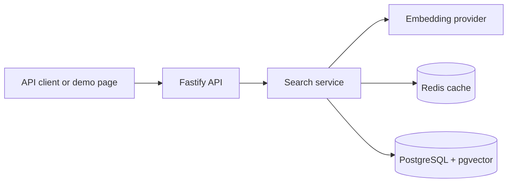

# Task 09 — Semantic Search API

**Status:** Initial scaffold only. Functional implementation has not started.

This project will become a backend service that combines PostgreSQL, vector embeddings, semantic product search, and Redis caching. At this stage, the repository contains only the project structure, planning documents, and configuration examples needed to begin implementation safely.

## Objective

Build a search API that understands the meaning of a query instead of relying only on exact keyword matches. The planned service will store product data and embeddings in PostgreSQL, rank results by semantic similarity, and cache repeated searches in Redis.

## Planned capabilities

- Product ingestion and validation
- Local text embedding generation
- Vector storage in PostgreSQL with `pgvector`
- Semantic similarity search
- Redis caching with a defined expiration policy
- Health and readiness endpoints
- Structured logging and error handling
- Automated unit, integration, and acceptance tests
- A small browser-based demo for portfolio screenshots

## Planned architecture



## Planned technology stack

- Node.js and TypeScript
- Fastify
- PostgreSQL and `pgvector`
- Redis
- Prisma or a compatible PostgreSQL data-access layer
- A local sentence-transformer model
- Vitest and Supertest
- Docker Compose for local infrastructure

The final choices will be confirmed during the first implementation milestone. No runtime dependency has been installed yet.

## Current repository structure

```text
task-09-semantic-search/
├── docs/
│   ├── evidence/
│   └── SPEC.md
├── migrations/
├── scripts/
├── src/
│   ├── config/
│   ├── errors/
│   ├── lib/
│   ├── middleware/
│   ├── modules/
│   │   ├── products/
│   │   └── search/
│   └── public/demo/
├── tests/
│   ├── acceptance/
│   ├── integration/
│   ├── setup/
│   └── unit/
├── .env.example
├── .gitignore
├── package.json
└── tsconfig.json
```

Empty implementation directories are intentional. Their purpose is to make the planned boundaries visible without presenting unfinished code as a working solution.

## Implementation roadmap

- [x] Define the technical specification
- [x] Create the initial folder structure
- [x] Add safe environment-variable examples
- [ ] Configure the TypeScript application and dependencies
- [ ] Start PostgreSQL with `pgvector` and Redis locally
- [ ] Design product and embedding persistence
- [ ] Implement embedding generation
- [ ] Implement semantic search and ranking
- [ ] Add caching and invalidation rules
- [ ] Build the browser demo
- [ ] Add automated tests and evidence
- [ ] Document final setup and API usage

## Current command

The only available command confirms the current scaffold status:

```bash
npm run scaffold:status
```

Development, test, build, and demo commands will be added only when their corresponding functionality exists.

## Planned portfolio evidence

When the task is complete, `docs/evidence/` will contain a checklist for screenshots and recordings. The intended visual evidence includes:

- A semantic query and ranked results in the browser demo
- PostgreSQL records with stored embedding metadata
- A Redis cache hit demonstrated through logs or metrics
- Passing automated tests

## Documentation

- [Detailed technical specification](docs/SPEC.md)
- [Shared project standards](../TASK_PROJECT_STANDARDS.md)

This task is part of the [Elevvo Backend Development Internship portfolio](../README.md).
