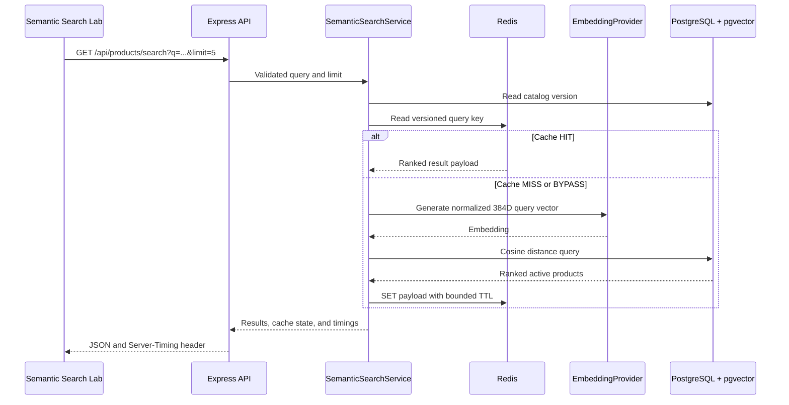

# Architecture

## Request flow



## Component boundaries

- `EmbeddingProvider` converts text into normalized vectors. The current adapter uses Transformers.js and a concurrency-safe lazy model singleton.
- `ProductRepository` owns parameterized SQL, pgvector serialization, persistence, transactions, and catalog versioning.
- `SearchResultCache` owns the cache-aside contract and treats Redis as optional infrastructure.
- `SemanticSearchService` orchestrates cache lookup, embedding, database ranking, cache write, timing, and per-process single-flight behavior.
- Express controllers validate transport input and add request metadata without containing domain logic.

## Persistence

PostgreSQL is the source of truth. Product rows store searchable fields, a 384-dimensional vector, the exact model name, a SHA-256 content hash, and embedding timestamps. An HNSW index uses `vector_cosine_ops`.

One `catalog_metadata` row stores a monotonically increasing version. The version is included in every cache key, so a product change invalidates old search results logically without scanning Redis.

## Cache key

```text
task09:search:v1:{modelFingerprint}:{catalogVersion}:{limit}:{querySha256}
```

Raw user queries never appear in keys. Cache values exclude request IDs and per-request timing. A Redis outage changes the public cache state to `BYPASS`; PostgreSQL search still runs.

## Product updates

Searchable text is canonicalized and hashed before an update. When the hash or model changes, the replacement embedding is generated before persistence. Product fields, vector metadata, and catalog version then change in one transaction. A price-only update increments the version without regenerating the vector.

## Operational isolation

Compose uses Task 9-specific container, network, volume, and host-port names:

- API: `3009`
- Development PostgreSQL: `5439`
- Test PostgreSQL: `5449`
- Redis: `6389`

No runtime import or process dependency exists on another internship task.
