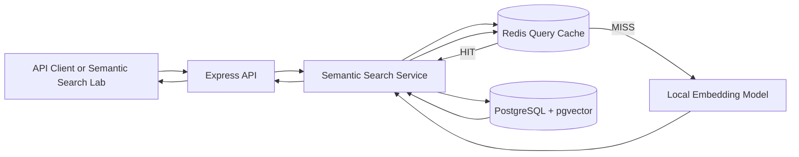

# Task 9 Implementation Specification

## 1. Document status

| Field | Value |
|---|---|
| Project | Task 9 - AI-Powered Semantic Search and Vector Embedding Pipeline |
| Status | Approved implementation specification; code not started |
| Repository directory | `task-09-semantic-search` |
| Primary language | English |
| Planned API URL | `http://localhost:3009` |
| Planned demonstration URL | `http://localhost:3009/demo` |

This document is the implementation contract for Task 9. Any intentional
deviation must be recorded in an Architecture Decision Record before the code is
changed.

## 2. Product outcome

Build an independent backend service that finds products by meaning rather than
literal keyword matching. A natural-language query such as "something warm and
light for a snowy hike" must retrieve the most contextually relevant catalog
items even when the product text does not contain the exact query sentence.

The service must generate dense embeddings, persist them beside products, rank
results by cosine similarity, cache recurring searches in Redis, and provide a
clear functional demonstration suitable for a portfolio screenshot.

## 3. Source requirement summary

The official task requires:

- TypeScript and Express.js;
- product-text embeddings generated with Sentence Transformers or a supported
  embedding API;
- vector storage in PostgreSQL with pgvector or a dedicated vector database;
- `GET /api/products/search`;
- cosine-similarity ranking;
- Redis caching with TTL for recurring queries;
- warm search responses below 100 ms;
- optional Arabic and English multilingual support.

The supporting modules add the following principles:

- use cache-aside: check Redis, load from the primary store on a miss, then
  cache the result with a TTL;
- keep PostgreSQL as the structured source of truth;
- use local containers for reproducible infrastructure;
- preserve the semantic-search module for later integration into the Task 10
  e-commerce capstone.

## 4. Project-wide standards

This repository must comply with `TASK_PROJECT_STANDARDS.md`.

In particular:

- every authored artifact must be in English;
- the repository must run independently from every other task;
- a local `task.bat` must operate only on Task 9 resources;
- the implementation must include a functional screenshot-ready artifact;
- no real API keys, credentials, user data, or machine-specific paths may be
  committed;
- planned features must never be presented as implemented features.

Multilingual search is explicitly deferred. This keeps all demonstration data
in English and protects the required scope. It may be added only after every
mandatory acceptance criterion passes.

## 5. Scope

### 5.1 Included

- an English product catalog with deterministic seed data;
- local server-side embedding generation;
- persisted 384-dimensional product embeddings;
- exact cosine-similarity search through pgvector;
- an HNSW cosine index for the production-oriented query path;
- Redis cache-aside for repeated search queries;
- explicit cache HIT, MISS, and BYPASS metadata;
- product updates that regenerate embeddings when searchable text changes;
- a command that backfills missing or stale embeddings;
- health, readiness, catalog, search, and product-update endpoints;
- unit, integration, HTTP, relevance, and performance tests;
- a minimal Semantic Search Lab served by Express;
- repeatable benchmark and evidence-generation commands;
- a Windows launcher for run, demo, test, verify, seed, and stop workflows.

### 5.2 Excluded

- authentication and role-based access control;
- checkout, carts, orders, and payments;
- cloud deployment;
- a general-purpose chat interface;
- generative AI responses;
- model training or fine-tuning;
- multiple active embedding providers;
- hybrid keyword/vector ranking in the mandatory version;
- multilingual search in the mandatory version;
- a framework-based frontend application.

## 6. Technical decisions

### 6.1 Runtime and API

- Use a current LTS release of Node.js supported by all selected packages.
- Use TypeScript in strict mode and ECMAScript modules.
- Use Express for HTTP routing.
- Use Zod for environment, parameter, and payload validation.
- Use `pg` for PostgreSQL access and explicit parameterized SQL.
- Use the official `redis` Node.js client.
- Use Jest and Supertest for automated tests.

Dependency versions must be pinned through `package-lock.json` during
implementation. The specification intentionally avoids floating version claims.

### 6.2 Embedding provider

Use `@huggingface/transformers` with the local ONNX-compatible model
`Xenova/all-MiniLM-L6-v2`.

Reasons:

- it runs server-side in Node.js without a Python sidecar;
- it avoids paid API calls and secret management for this standalone task;
- it is designed for sentence and short-paragraph similarity;
- it produces 384-dimensional vectors suitable for compact local storage;
- model files can be cached after the initial download.

The feature-extraction pipeline must use mean pooling and normalized output. The
model must be loaded through a single shared lazy instance. Concurrent requests
must not initialize multiple model copies.

The first model download requires internet access. The README must state this
clearly. The cache directory must be configurable and ignored by Git. After the
model is cached, the project must support a documented local-only mode that
disables remote model loading.

### 6.3 Vector database

Use PostgreSQL with the pgvector extension rather than a second database.

Reasons:

- products and vectors remain transactionally connected;
- the choice integrates naturally with the later e-commerce capstone;
- pgvector supports cosine distance through the `<=>` operator;
- cosine similarity can be returned as `1 - cosine_distance`;
- an HNSW index can demonstrate an industry-oriented retrieval design.

### 6.4 Cache

Use Redis with an explicit cache-aside strategy. Cache only complete search
result sets for normalized exact queries. This is result caching, not semantic
cache matching between different queries.

Redis is an optimization, not the source of truth. If Redis is unavailable, a
request must still search PostgreSQL and return `cache.status = "BYPASS"`.

## 7. High-level architecture



### 7.1 Search request flow

1. Validate and normalize the query and result limit.
2. Read the current catalog version.
3. Build a deterministic cache key.
4. Return the cached result immediately on a Redis HIT.
5. On a MISS or BYPASS, generate one normalized query embedding.
6. Query active products by cosine distance in PostgreSQL.
7. Map distance to a bounded similarity score.
8. Cache the result with a TTL after a successful MISS.
9. Return results with cache and timing metadata.

### 7.2 Product update flow

1. Validate the update payload.
2. Load the existing product.
3. Build the proposed searchable text.
4. If searchable text changed, generate the replacement embedding first.
5. Update product fields, embedding metadata, and catalog version in one
   database transaction.
6. Do not delete every Redis key. The new catalog version makes old keys
   unreachable, and their TTL removes them naturally.

If embedding generation fails, no searchable product change may be persisted.

## 8. Planned project structure

```text
task-09-semantic-search/
|-- docs/
|   |-- SPEC.md
|   |-- ARCHITECTURE.md
|   |-- API.md
|   |-- BENCHMARK.md
|   `-- evidence/
|       `-- README.md
|-- migrations/
|-- scripts/
|   |-- migrate.ts
|   |-- seed.ts
|   |-- reindex.ts
|   |-- benchmark.ts
|   `-- capture-evidence.ts
|-- src/
|   |-- config/
|   |-- errors/
|   |-- lib/
|   |-- middleware/
|   |-- modules/
|   |   |-- products/
|   |   `-- search/
|   |-- public/
|   |   `-- demo/
|   |-- app.ts
|   `-- server.ts
|-- tests/
|   |-- acceptance/
|   |-- integration/
|   |-- unit/
|   `-- setup/
|-- .env.example
|-- .gitignore
|-- compose.yaml
|-- jest.config.cjs
|-- package-lock.json
|-- package.json
|-- README.md
|-- task.bat
|-- tsconfig.build.json
`-- tsconfig.json
```

Generated model files, coverage, build output, benchmark raw samples, local
environment files, and database volumes must not be committed.

## 9. Data model

### 9.1 PostgreSQL extensions

The first migration must enable:

```sql
CREATE EXTENSION IF NOT EXISTS vector;
```

No schema change may depend on a manual database-console action.

### 9.2 Product

| Field | Logical type | Required | Rule |
|---|---|---:|---|
| id | Big integer | Yes | Generated primary key |
| sku | Text | Yes | Unique and immutable |
| name | Text | Yes | 2 to 160 characters |
| description | Text | Yes | 20 to 5,000 characters |
| category | Text | Yes | Normalized display category |
| tags | Text array | Yes | Empty array allowed; unique normalized values |
| price | Decimal(12,2) | Yes | Greater than zero |
| active | Boolean | Yes | Defaults to true |
| embedding | vector(384) | Yes | Finite normalized values only |
| embeddingModel | Text | Yes | Exact configured model identifier |
| embeddingContentHash | Text | Yes | SHA-256 of canonical searchable text |
| embeddedAt | Timestamp | Yes | Set when the vector is generated |
| createdAt | Timestamp | Yes | Database-generated |
| updatedAt | Timestamp | Yes | Updated on every change |

Required indexes:

- unique index on `sku`;
- B-tree index on `(active, category)`;
- HNSW index on `embedding vector_cosine_ops`;
- index on `embeddingContentHash` for stale-vector diagnostics.

### 9.3 Catalog metadata

Store one catalog metadata record containing a positive integer `version`.
Increment it in the same transaction as every change that can affect search
results, including active state, name, description, category, tags, price, or
embedding.

The version is part of every cache key and provides deterministic logical
invalidation without a Redis key scan.

## 10. Embedding contract

### 10.1 Canonical product text

Build one stable text representation:

```text
Product: {name}
Category: {category}
Description: {description}
Tags: {comma-separated tags}
```

Rules:

- trim every field;
- collapse repeated whitespace;
- sort normalized tags before joining them;
- do not include ID, SKU, price, stock, timestamps, or internal metadata;
- compute SHA-256 from the exact canonical text;
- regenerate the vector only when the hash or configured model changes.

### 10.2 Query text

- Accept 3 to 300 visible characters after trimming.
- Collapse repeated whitespace.
- Preserve the original query for display.
- Use lowercase normalized text only for cache-key generation.
- Pass the cleaned original text to the embedding model.
- Reject empty, control-character-only, or oversized input before inference.

### 10.3 Model lifecycle

- Load the model once per process through a concurrency-safe singleton.
- Expose model readiness separately from process liveness.
- Warm the model with a harmless English sentence during startup.
- Fail readiness until PostgreSQL, Redis policy, and the model are ready.
- A Redis outage does not make the API unready because BYPASS is supported.
- Never log vectors or the full model cache path.

### 10.4 Reindex command

The reindex command must:

- find products whose vector is missing, stale, or generated by another model;
- process products in bounded batches;
- update each product safely without holding one transaction for the full
  catalog;
- report processed, skipped, failed, and remaining counts;
- return a non-zero exit code if any product fails;
- support a dry-run mode;
- remain idempotent.

## 11. Vector search contract

The mandatory query shape is equivalent to:

```sql
SELECT
  id,
  sku,
  name,
  description,
  category,
  tags,
  price,
  1 - (embedding <=> $1::vector) AS similarity
FROM products
WHERE active = TRUE
ORDER BY embedding <=> $1::vector
LIMIT $2;
```

All values must be parameterized. Vector serialization must reject non-finite
numbers and arrays whose length is not exactly 384.

The public similarity score must be clamped to the range 0 through 1 and rounded
only at the response boundary. Ranking must use the unrounded database value.

The default limit is 5. The allowed range is 1 through 20.

## 12. Cache contract

### 12.1 Key format

Use a namespaced, versioned format equivalent to:

```text
task09:search:v1:{modelFingerprint}:{catalogVersion}:{limit}:{querySha256}
```

The key must never contain the raw user query.

### 12.2 Value and TTL

- Store only the ranked result data and stable search metadata.
- Do not cache request IDs, per-request duration, or `cache.status`.
- Use `SET` with the `EX` option.
- Default TTL: 300 seconds.
- Make the TTL configurable within a validated range of 30 to 3,600 seconds.
- Expose the configured TTL and, for demonstration only, remaining TTL through
  safe response metadata.

### 12.3 HIT, MISS, and BYPASS

- `HIT`: Redis returned a valid cached payload.
- `MISS`: Redis was reachable, no valid value existed, and the service computed
  the search.
- `BYPASS`: Redis was unavailable or returned malformed cached data, so the
  service computed the search without caching.

Malformed cached JSON must be deleted if possible and treated as BYPASS. Redis
failures must be logged once with safe structured context and must not leak raw
connection details to clients.

An in-process single-flight map should collapse simultaneous identical MISS
requests within one API instance. A distributed lock is optional and must not
delay the mandatory implementation.

## 13. HTTP API

All API responses use JSON except the demonstration page and its static assets.
Every response must include an `X-Request-Id` header.

### 13.1 Routes

| Method | Route | Purpose | Success |
|---|---|---|---:|
| GET | `/health/live` | Process liveness | 200 |
| GET | `/health/ready` | Database and model readiness | 200 or 503 |
| GET | `/api/products` | Paginated active catalog | 200 |
| GET | `/api/products/search` | Semantic search | 200 |
| GET | `/api/products/:id` | Product details without raw vector | 200 |
| PATCH | `/api/products/:id` | Update a product and regenerate when required | 200 |
| GET | `/demo` | Semantic Search Lab | 200 |

The `/search` route must be registered before `/:id`.

### 13.2 Search request

```http
GET /api/products/search?q=something%20warm%20for%20a%20snowy%20hike&limit=5
```

### 13.3 Search response

```json
{
  "data": [
    {
      "id": "1",
      "sku": "OUT-ALPINE-SHELL",
      "name": "Alpine Insulated Shell",
      "description": "A breathable outer layer designed for cold mountain treks.",
      "category": "Outdoor",
      "tags": ["breathable", "cold-weather", "lightweight"],
      "price": "189.90",
      "similarity": 0.84
    }
  ],
  "meta": {
    "query": "something warm for a snowy hike",
    "limit": 5,
    "resultCount": 5,
    "cache": {
      "status": "MISS",
      "ttlSeconds": 300
    },
    "timing": {
      "totalMs": 47.2,
      "embeddingMs": 31.6,
      "databaseMs": 4.8,
      "cacheMs": 0.9
    },
    "model": "Xenova/all-MiniLM-L6-v2",
    "catalogVersion": 1,
    "requestId": "generated-request-id"
  }
}
```

On a HIT, `embeddingMs` and `databaseMs` must be zero because neither operation
is executed. Timing values are examples, not fixed expected numbers.

### 13.4 Product update rules

- SKU is immutable.
- Searchable field changes regenerate the vector before persistence.
- Price-only changes increment the catalog version because price is returned in
  cached search results, but they do not regenerate the vector.
- Unknown fields are rejected.
- Raw embeddings cannot be supplied or retrieved through the public API.

### 13.5 Error format

```json
{
  "error": {
    "code": "VALIDATION_ERROR",
    "message": "The search query must contain between 3 and 300 characters.",
    "details": [],
    "requestId": "generated-request-id"
  }
}
```

| Situation | HTTP | Stable code |
|---|---:|---|
| Invalid query, limit, ID, or payload | 400 | `VALIDATION_ERROR` |
| Product not found | 404 | `PRODUCT_NOT_FOUND` |
| Duplicate SKU | 409 | `SKU_CONFLICT` |
| Embedding model unavailable | 503 | `EMBEDDING_UNAVAILABLE` |
| PostgreSQL unavailable | 503 | `DATABASE_UNAVAILABLE` |
| Unexpected failure | 500 | `INTERNAL_ERROR` |

Redis failure is not a public error because the request uses BYPASS mode.

## 14. Configuration

The implementation must validate environment variables at startup.

| Variable | Local default | Purpose |
|---|---|---|
| `NODE_ENV` | `development` | Runtime mode |
| `PORT` | `3009` | API and demo port |
| `DATABASE_URL` | Safe local URL on port 5439 | pgvector database |
| `TEST_DATABASE_URL` | Safe local URL on port 5449 | isolated test database |
| `REDIS_URL` | `redis://localhost:6389` | Redis cache |
| `EMBEDDING_MODEL` | `Xenova/all-MiniLM-L6-v2` | Model identifier |
| `EMBEDDING_DIMENSIONS` | `384` | Vector contract |
| `MODEL_CACHE_DIR` | `.cache/models` | Ignored local model cache |
| `ALLOW_REMOTE_MODELS` | `true` in development | Initial model download policy |
| `SEARCH_CACHE_TTL_SECONDS` | `300` | Result-cache TTL |
| `LOG_LEVEL` | `info` | Structured logging level |

`.env.example` must contain placeholders and safe local values only. Tests must
not silently connect to the development database.

## 15. Local infrastructure and isolation

`compose.yaml` must define:

- a PostgreSQL image with pgvector support on host port 5439;
- an isolated pgvector test database on host port 5449;
- Redis on host port 6389;
- health checks for both technologies;
- task-specific container, network, and volume names.

The Compose project name must be unique to Task 9. Stopping Task 9 must not stop
Task 5 or any later task.

The API may run on the host during development. A production Dockerfile is not a
mandatory Task 9 deliverable because container packaging is assessed in Task 7.

## 16. Windows launcher

The completed repository must provide `task.bat` with an interactive menu and
these commands:

| Command | Required behavior |
|---|---|
| `run` | Start Task 9 PostgreSQL and Redis, migrate, warm the model, and run the API |
| `demo` | Ensure the service is ready and open or print the `/demo` URL |
| `test` | Start isolated dependencies, migrate, run tests, and stop test services |
| `verify` | Run typecheck, tests, build, and the deterministic relevance suite |
| `seed` | Migrate, create deterministic products, and generate all embeddings |
| `stop` | Stop only Task 9 containers and its API process when safely identifiable |
| `help` | Explain all commands and first-model-download behavior |

The launcher must propagate non-zero exit codes and must not reset a persistent
development volume unless the user selects an explicitly destructive command.

## 17. Deterministic seed catalog

Create at least 16 active products across Outdoor, Travel, Home, Fitness, and
Electronics, plus one inactive product. Product descriptions must contain enough
meaningful detail for semantic retrieval and must not simply copy the acceptance
queries.

Mandatory anchor products:

| Product | Description concept | Required tags |
|---|---|---|
| Alpine Insulated Shell | Breathable lightweight outer layer for cold mountain treks | `cold-weather`, `lightweight`, `breathable` |
| Travel Silence Headphones | Over-ear active noise reduction for flights and commuting | `noise-cancelling`, `travel`, `wireless` |
| Adjustable Bedside Reading Lamp | Warm focused light with dimming for nighttime reading | `dimmable`, `reading`, `bedside` |
| Percussion Recovery Device | Portable muscle recovery device for post-training soreness | `recovery`, `fitness`, `portable` |
| Insulated Cooler Backpack | Hands-free insulated carrier for chilled food and beach trips | `insulated`, `outdoor`, `food-storage` |

The remaining products must create plausible distractors so that relevance is
actually tested. The seed command must be deterministic and idempotent.

## 18. Semantic relevance acceptance set

The acceptance suite uses natural language that avoids copying the product name.

| Query | Expected product | Requirement |
|---|---|---|
| `something warm and light for a snowy hike` | Alpine Insulated Shell | Appears in top 3 |
| `quiet headphones for a long flight` | Travel Silence Headphones | Appears in top 3 |
| `a soft light for reading in bed at night` | Adjustable Bedside Reading Lamp | Appears in top 3 |
| `help my sore muscles after a hard workout` | Percussion Recovery Device | Appears in top 3 |
| `carry cold drinks and lunch to the beach` | Insulated Cooler Backpack | Appears in top 3 |

All five cases must pass against the real local model and real pgvector query.
Mocks are not allowed in the relevance acceptance suite.

## 19. Semantic Search Lab

### 19.1 Purpose

`GET /demo` must serve a small, read-only interface that demonstrates the real
API. It is a portfolio surface, not a separate product frontend.

Use plain HTML, CSS, and browser JavaScript served by Express. Do not add React,
a bundler, authentication, or a second application process.

### 19.2 Required visual content

The page must contain:

- title: `Semantic Search Lab`;
- subtitle explaining meaning-based product discovery;
- a search input and Search button;
- five curated query chips from the acceptance set;
- ranked product cards with rank, name, category, price, and similarity bar;
- a visible cache badge: `MISS`, `HIT`, or `BYPASS`;
- total, embedding, database, and cache timing values;
- current model identifier and catalog version;
- a `Run cache comparison` action that executes the same query twice;
- a side-by-side cold/warm comparison suitable for one screenshot;
- a compact architecture strip showing Query, Embedding, Redis, pgvector, and
  Ranked Results;
- an accessible error state and loading state.

### 19.3 Visual rules

- Use a clean dark or light theme with high contrast and consistent spacing.
- Keep the main evidence view readable at 1440 by 900 pixels without scrolling.
- Use only English labels.
- Do not show raw vectors, stack traces, connection strings, or filesystem paths.
- Do not fabricate latency or cache state. Render API response metadata.
- Keep seed result order deterministic when scores are equal by using product ID
  as the secondary order.

### 19.4 Screenshot scenarios

The evidence guide must request at least:

1. semantic results for `something warm and light for a snowy hike`, showing the
   expected product among the top results;
2. the side-by-side MISS versus HIT comparison with the warm response under
   100 ms;
3. a successful automated test and relevance-suite summary;
4. the architecture diagram rendered in the repository README.

Screenshots must be saved under `docs/evidence/` only when they are final and
free of personal or machine-specific information.

## 20. Testing strategy

### 20.1 Unit tests

- query normalization and validation;
- canonical product-text generation;
- embedding-content hashing;
- vector length and finite-number validation;
- cache-key generation without raw query leakage;
- HIT, MISS, BYPASS, and malformed-cache behavior;
- similarity mapping and response serialization;
- stable application-error mapping;
- model singleton concurrency.

### 20.2 PostgreSQL and Redis integration tests

- migrations apply to an empty pgvector database;
- the vector extension and 384-dimensional column exist;
- the HNSW cosine index exists;
- seed and reindex are idempotent;
- product vectors remain attached to the correct product;
- cosine search returns ordered scores;
- inactive products never appear;
- a searchable product update replaces its vector and hash;
- a price-only update does not regenerate the vector;
- catalog version increments atomically;
- Redis values receive the configured TTL;
- the second identical query is a HIT;
- a catalog change makes an old key unreachable;
- Redis outage produces BYPASS with a successful database search.

### 20.3 HTTP tests

- health and readiness states;
- valid search response contract;
- missing, blank, oversized, and invalid-limit queries;
- product retrieval without raw embedding data;
- update success and failure paths;
- standardized 404, 409, 503, and 500 responses;
- request ID propagation;
- demo page and static assets load successfully.

### 20.4 Real-model acceptance tests

- run the five relevance queries in Section 18;
- use the real local model, PostgreSQL, and pgvector;
- allow the suite to run separately from fast unit tests;
- cache the downloaded model between local runs and CI runs where permitted;
- fail with a clear setup message if the model has never been downloaded and
  remote loading is disabled.

## 21. Performance contract

### 21.1 Mandatory target

After one successful warm-up request, repeated identical searches served from
Redis must complete in less than 100 ms at the API boundary in the documented
local environment.

### 21.2 Benchmark method

- start healthy local Task 9 dependencies;
- seed the deterministic catalog;
- warm the model before measuring;
- choose one acceptance query and execute one explicit MISS;
- execute 100 sequential HIT requests from the local machine;
- record minimum, median, p95, p99, maximum, and cache-hit count;
- require 100 Redis HIT responses;
- require p95 below 100 ms;
- investigate and document any sample at or above 100 ms;
- run a second 20-request concurrent sample to identify cache instability;
- write a human-readable summary to `docs/BENCHMARK.md`;
- keep raw benchmark output out of Git unless intentionally curated.

CI must verify functionality but must not use shared-runner timing as the only
performance gate. The final benchmark environment, hardware summary, date, and
method must be documented honestly.

## 22. Observability

Use structured logs with:

- request ID;
- route and method;
- status code;
- total duration;
- cache status;
- result count;
- catalog version;
- safe error code when applicable.

For MISS searches, include embedding and database durations. Do not log the raw
query by default; log its SHA-256 prefix if correlation is necessary. Never log
embeddings, database URLs, Redis URLs, environment contents, or stack traces in
production responses.

The HTTP response should also set a `Server-Timing` header for cache, embedding,
database, and total durations when those measurements exist.

## 23. Reliability and security

- Validate all external input before cache, model, or database access.
- Parameterize SQL values and allow-list dynamic sort behavior.
- Reject raw vector input from clients.
- Limit query length and result count to bound CPU and response size.
- Apply a request timeout around embedding generation.
- Limit concurrent embedding work to protect process memory and CPU.
- Gracefully close the HTTP server, PostgreSQL pool, Redis client, and model
  resources on termination.
- Return safe errors without dependency messages or secrets.
- Use dependency lockfiles and audit production dependencies before delivery.
- Do not claim Redis durability; PostgreSQL remains the source of truth.

## 24. Implementation sequence

### Day 1 - Foundation and decisions

- create the TypeScript project and strict configuration;
- add validated environment configuration and structured errors;
- create Compose services and health checks;
- create SQL migrations for pgvector, products, catalog metadata, and indexes;
- record the model, vector dimension, and cache decisions.

### Day 2 - Embedding pipeline and catalog

- implement the model singleton and canonical-text builder;
- implement vector validation and serialization;
- create deterministic seed products;
- implement the idempotent seed and reindex commands;
- verify stored vectors and content hashes.

### Day 3 - Search and cache

- implement cosine-similarity SQL and result mapping;
- implement the search endpoint and error contract;
- implement Redis cache-aside, TTL, versioned keys, and BYPASS behavior;
- implement product updates and atomic catalog-version changes.

### Day 4 - Quality and performance

- complete unit, integration, HTTP, and relevance tests;
- implement the benchmark command;
- measure MISS and HIT paths;
- tune startup, Redis payloads, and indexes without weakening correctness.

### Day 5 - Demonstration and delivery

- implement the Semantic Search Lab;
- add the local `task.bat` workflow;
- finalize architecture, API, benchmark, and evidence documentation;
- capture clean screenshots from the real implementation;
- run the complete verification from a clean local setup.

## 25. Acceptance criteria

### AC-01 - Real embeddings

Every active seeded product has a real 384-dimensional embedding generated by
the configured local model and linked to the correct record.

### AC-02 - Semantic retrieval

All five natural-language acceptance queries return the expected product in the
top three results without using literal SQL `LIKE` ranking.

### AC-03 - Cosine ranking

The database orders results by pgvector cosine distance and the API exposes a
safe similarity score.

### AC-04 - Embedding lifecycle

Changing searchable product text changes the content hash and vector. Reindexing
without changes skips the product.

### AC-05 - Cache behavior

The first query is a MISS, the identical repeated query is a HIT, and Redis
stores the result with a positive bounded TTL.

### AC-06 - Warm latency

The documented local benchmark proves a p95 below 100 ms for 100 sequential
Redis HIT searches, with all observed deviations reported honestly.

### AC-07 - Graceful Redis degradation

When Redis is unavailable, search still succeeds through PostgreSQL and returns
`BYPASS` without exposing connection details.

### AC-08 - Reproducible infrastructure

An empty local environment can start pgvector and Redis, apply migrations, seed
products, generate embeddings, and serve the API using documented commands.

### AC-09 - Automated quality

Strict type checking, all required tests, the real-model relevance suite, and
the production build pass through `task.bat verify`.

### AC-10 - Portfolio evidence

The Semantic Search Lab displays real ranked results, similarity, cache status,
and timings in a clean 1440 by 900 screenshot without secrets or debug noise.

### AC-11 - English-only repository

README, documentation, implementation names, comments, logs, errors, tests,
seed content, and demonstration labels are in English.

### AC-12 - Project isolation

Task 9 can run, test, and stop without importing Task 5 source code or changing
Task 5 processes, containers, volumes, or data.

## 26. Requirement traceability

| Official requirement | Specification sections | Required evidence |
|---|---|---|
| AI NLP embedding pipeline | 6.2, 10, AC-01 | Model metadata, seeded vectors, tests |
| Product descriptions to dense vectors | 9, 10 | Hash/vector diagnostics and reindex report |
| PostgreSQL with pgvector or vector database | 6.3, 9, 11 | Migration and index inspection |
| `/api/products/search` | 13 | API contract and HTTP tests |
| Cosine similarity | 11, AC-03 | SQL query and ordered response |
| Contextually relevant products | 17, 18, AC-02 | Five-query relevance suite |
| Redis query-result cache with TTL | 12, AC-05 | MISS/HIT response and TTL evidence |
| Warm response below 100 ms | 21, AC-06 | Reproducible benchmark report |
| TypeScript and Express | 6.1 | Source tree, typecheck, build |
| Portfolio-ready demonstration | 19, AC-10 | Semantic Search Lab screenshots |

## 27. Deliverables

- independent Task 9 repository content;
- strict TypeScript Express API;
- versioned pgvector migrations;
- deterministic English seed catalog;
- local embedding provider and cached model workflow;
- semantic search endpoint;
- Redis cache-aside implementation;
- safe product-update and reindex flows;
- unit, integration, HTTP, relevance, and benchmark suites;
- Semantic Search Lab;
- `task.bat` launcher;
- README, API, architecture, benchmark, and evidence documentation;
- final screenshot package under `docs/evidence/`.

## 28. Definition of Done

Task 9 is complete only when:

- AC-01 through AC-12 pass;
- the project starts from a clean documented environment;
- no vector or search result is fabricated for the demo;
- Redis HIT, MISS, TTL, and BYPASS are demonstrated;
- the five semantic relevance cases pass with the real model;
- the warm-cache performance claim is backed by a saved methodology and result;
- all tests and the production build pass;
- the demo is screenshot-ready and contains no sensitive information;
- no secret, model cache, build output, or database data is committed;
- all final repository content is in English;
- limitations and deferred multilingual support are stated honestly.

## 29. Task 10 compatibility

The search module must remain separable behind these interfaces:

- `EmbeddingProvider` for text-to-vector generation;
- `ProductSearchRepository` for vector persistence and ranking;
- `SearchResultCache` for Redis access;
- `SemanticSearchService` for orchestration.

This allows Task 10 to reuse the behavior while replacing the standalone
catalog repository with the capstone's Prisma-backed product lifecycle. Public
search response fields should remain compatible with the Task 5 product fields
where practical: ID, SKU, name, description, category, price, and active state.

Do not create a runtime dependency on the Task 5 directory. Reuse happens later
through deliberate integration, not cross-repository imports.

## 30. References

### Internship material

- `../../tasks - backend/Backend Tasks.pdf` - official Task 9 requirements.
- `../../materials/Elevvo Backend Track - Module 7_ NoSQL & Performance.pdf` -
  Redis and cache-aside principles.
- `../../materials/Elevvo Backend Track - Module 9_ Distributed Concepts.pdf` -
  architectural scaling context.
- `../../materials/Elevvo Backend Track - Module 10_ E-Commerce Capstone.pdf` -
  semantic-search integration and capstone reuse.
- `../../PLANO_DE_ACAO_INTERNSHIP.md` - project order and internship plan.

### Primary technical references

- Transformers.js pipelines:
  https://huggingface.co/docs/transformers.js/api/pipelines
- Transformers.js server-side Node.js inference:
  https://huggingface.co/docs/transformers.js/en/tutorials/node
- `all-MiniLM-L6-v2` model card:
  https://huggingface.co/sentence-transformers/all-MiniLM-L6-v2
- Transformers.js-compatible model:
  https://huggingface.co/Xenova/all-MiniLM-L6-v2
- pgvector documentation:
  https://github.com/pgvector/pgvector
- Redis cache-aside guidance:
  https://redis.io/docs/latest/develop/use-cases/cache-aside/
- Redis `SET` expiration options:
  https://redis.io/docs/latest/commands/set/

