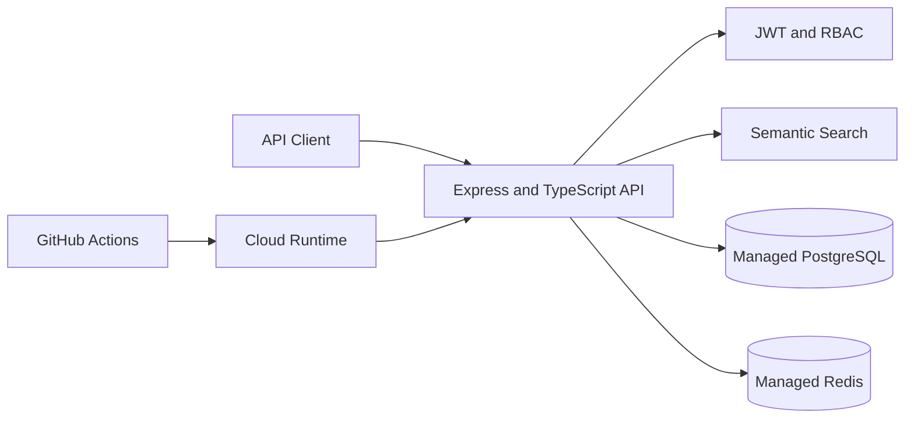

# Task 10 - Production-Grade E-Commerce System

## Status

**Planned.** This directory currently contains the portfolio and implementation
outline only. No cloud deployment or production-readiness claim has been made.

## Goal

Integrate the internship modules into one production-oriented e-commerce API and
deliver it through an automated cloud deployment pipeline with safe migrations,
health verification, and documented rollback behavior.

## Planned capabilities

- JWT authentication and role-based authorization for ADMIN and CUSTOMER;
- bcrypt password hashing, Helmet, restricted CORS, and login protection;
- PostgreSQL and Prisma relational persistence from Task 5;
- atomic cart checkout and inventory protection;
- semantic product search from Task 9;
- Redis cache-aside for catalog and search routes;
- distributed Redis rate limiting;
- multi-stage Docker packaging and CI quality gates from Task 7;
- managed PostgreSQL and Redis infrastructure;
- secret management outside Git and container images;
- automated migrations, deployment, health checks, and smoke tests;
- documented rolling, blue/green, or atomic-release deployment behavior;
- tested rollback procedure.

## Planned architecture



## Planned repository structure

```text
task-10-production-ecommerce/
|-- .github/workflows/
|-- docs/
|   |-- architecture/
|   |-- deployment/
|   `-- evidence/
|-- prisma/
|-- src/
|-- tests/
|-- .env.example
|-- compose.yaml
|-- Dockerfile
|-- package.json
|-- README.md
`-- task.bat
```

## Planned local commands

```bat
task.bat run
task.bat demo
task.bat test
task.bat verify
task.bat seed
task.bat stop
```

These commands are placeholders in the project plan and do not exist yet.

## Planned portfolio evidence

- public health endpoint and successful smoke tests;
- authenticated catalog and checkout flow;
- semantic-search response from the deployed service;
- cache HIT/MISS and distributed rate-limit evidence;
- successful CI/CD deployment workflow;
- migration and rollback summary without exposed secrets.

## Definition of Done

Task 10 will be complete only when the integrated service is deployed, protected
by automated tests, verified after deployment, and supported by reproducible
security, migration, monitoring, and rollback evidence.

## Shared standards

This task follows [`../TASK_PROJECT_STANDARDS.md`](../TASK_PROJECT_STANDARDS.md).

